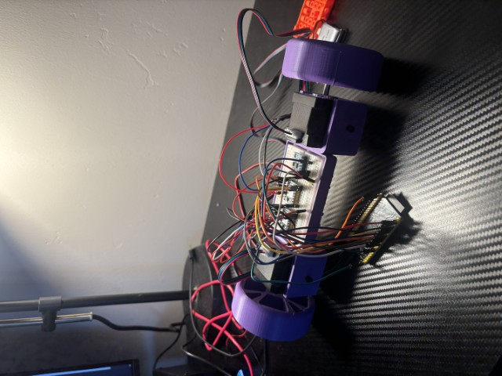
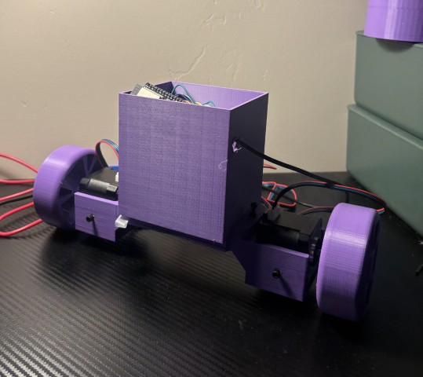
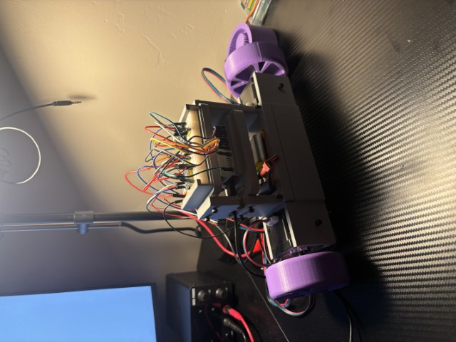
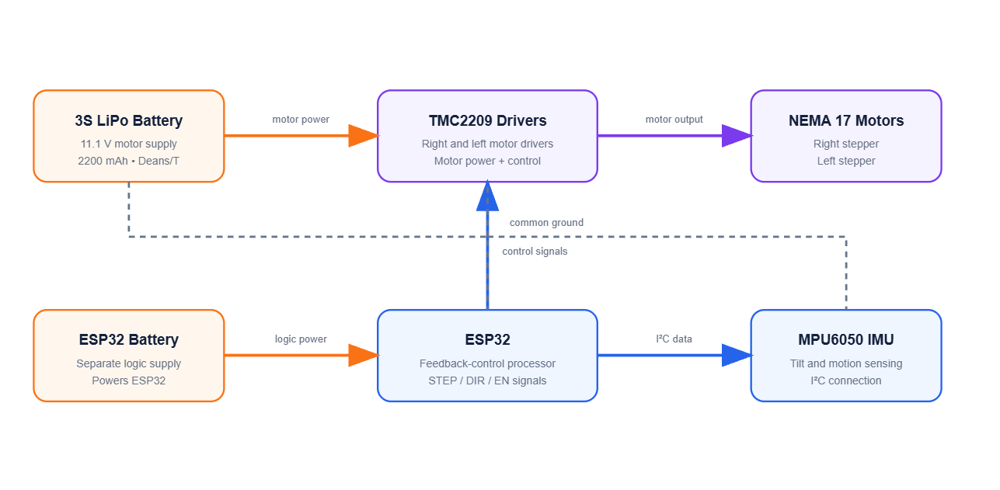

# Self-Balancing-Robot
ESP32 based self balancing robot developed to explore embedded systems, IMU sensing, stepper motor control, and feedback control.

## Version 1 — Initial Prototype

The first prototype was designed to establish communication between the ESP32, MPU6050 IMU, and NEMA 17 stepper motors while testing basic orientation-based motor control.

The robot uses a custom 3D-printed chassis and wheels to support the motors and electronics.

## Version 2 

Version 2 was developed to test whether the robot could recover from an external disturbance, such as being pushed near the top of the chassis.

## Version 3 

Version 3 introduced a major mechanical redesign focused on onboard power, component packaging, and system integration. The previous versions relied on an external power connection for the stepper motors, while Version 3 added a dedicated motor battery compartment within the lower chassis.

