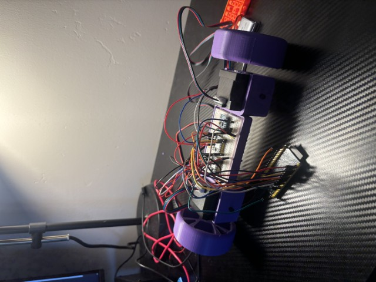

# Self-Balancing-Robot
ESP32 based self balancing robot developed to explore embedded systems, IMU sensing, stepper motor control, and feedback control.

## Version 1 — Initial Prototype

The first prototype was designed to establish communication between the ESP32, MPU6050 IMU, and NEMA 17 stepper motors while testing basic orientation-based motor control.

The robot uses a custom 3D-printed chassis and wheels to support the motors and electronics.

